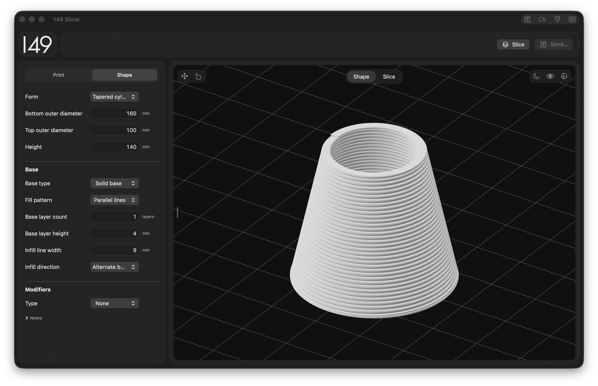
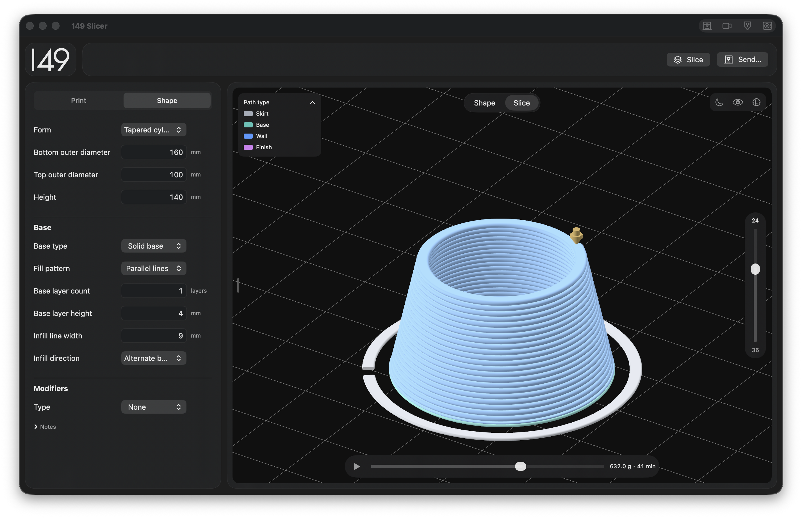

# 149 Slicer

A native macOS application for parametric modeling and 3D-printing toolpath generation, with a focus on pellet extrusion. Design a shape, configure the print, inspect the toolpath, and export a print file from one workspace.

**Apple Silicon · macOS 13 or later · English / 简体中文**

[Download](https://github.com/Morayla/149_Slicer/releases/latest) · [Report an issue](https://github.com/Morayla/149_Slicer/issues) · [149 Calibration](https://github.com/Morayla/149_Calibration)

## Design a shape



Choose a built-in shape and adjust its dimensions. The preview updates automatically. Configure the bottom and available modifiers, then position the object with the canvas move and Z-rotation tools.

- 17 built-in shape presets, including cylinders, tapered vessels, spiral forms, and structural profiles.
- Bottom fill, layer height, line width, and elephant-foot compensation controls where supported by the selected generator.
- Material presets with print settings and visual properties, including color, roughness, transmission, and refractive index.
- Dedicated `.149slicer` project files containing the current shape, modifiers, print settings, material appearance, and placement.

The application generates toolpaths from its built-in parametric shapes. It does not import arbitrary STL, OBJ, or STEP models.

## Inspect the slice



Click **Slice** to generate the toolpath. Use the vertical slider to select a layer and the bottom slider to inspect progress within it. The eye menu provides path-type, volumetric-flow, layer-height, and speed coloring, plus controls for travel moves, the nozzle, and the build plate.

The preview preserves the extruded bead profile and printing texture. Material refraction is a real-time rendering approximation, not an optical simulation of the finished print.

## Quick start

1. Download the Apple Silicon application from [Releases](https://github.com/Morayla/149_Slicer/releases/latest), unzip it, and move **149 Slicer.app** to Applications.
2. In **Print**, choose the printer and material. Open the material editor to adjust temperature, flow, retraction, pellet extrusion, and appearance. Custom materials are saved in the local material library.
3. In **Shape**, choose a preset and set its dimensions, bottom, and modifiers.
4. Click **Slice**, then inspect the layer sequence and toolpath coloring.
5. Use **File → Save Project** to save a `.149slicer` file, or **File → Export G-code** to export the print. Double-click a project file to reopen it.

The interface language is selectable in Settings; application appearance follows macOS. The canvas has its own black/white background control.

Ginger G1 pellet workflows and selected Bambu Lab printer workflows are included. Bambu print-package export requires Bambu Studio for the corresponding official start/end sequences. Builds are locally signed and are not Apple-notarized.

## Build from source

Requires an Apple Silicon Mac, macOS 13 or later, and a full Xcode installation with its command-line tools. No Python or JavaScript runtime is required.

```sh
git clone https://github.com/Morayla/149_Slicer.git
cd 149_Slicer
./scripts/build-app.sh
open "dist/149 Slicer.app"
```

The build script does not overwrite an existing application. For another build, supply a new output path:

```sh
./scripts/build-app.sh "/private/tmp/149 Slicer-new.app"
```

## Source layout

```text
src/app/             Application workspace and app-specific logic
src/app/engine/      Geometry, slicing, and print-file generation
src/shared/          Shared UI components and interchange formats
assets/branding/     Source logo and application icon
resources/           App metadata, translations, and runtime data
scripts/             Shell entry points for builds
tools/               Swift build utilities
docs/screenshots/    Interface examples used in this guide
build/               Generated intermediate files (not tracked)
dist/                Local application builds (not tracked)
```

The interface uses SwiftUI and AppKit. Geometry and slicing are implemented in Swift; the SceneKit viewport uses Metal. Device control panels display device-provided interfaces through WebKit.

[149 Calibration](https://github.com/Morayla/149_Calibration) is developed and distributed separately. It exports compensation presets that can be imported into Slicer's compensation controls. Each repository includes the UI and interchange components it needs and builds independently.

## Repository conventions

Both 149 repositories use the same layout and naming rules:

- Directories, shell scripts, and data assets use lowercase names with hyphens between words.
- Swift files use `UpperCamelCase` names matching their primary type or responsibility.
- Apple-defined names such as `Info.plist` and `en.lproj/Localizable.strings` retain their standard spelling.
- `src/app/` contains application-specific code; `src/shared/` contains the shared components each repository needs to build independently.
- `assets/` holds source artwork and model assets; `resources/` holds app metadata, translations, and runtime data.
- Generated intermediates belong in `build/`; distributable applications belong in `dist/`. Neither directory is committed.
- App-specific subdirectories are added only when needed; no empty placeholder directories are required.
